# Gerenciador de Arquivos|dde-file-manager|

## Visão geral

O Gerenciador de Arquivos é uma ferramenta completa e fácil de usar. Ele combina os recursos e o layout conhecidos de um gerenciador de arquivos com uma navegação simplificada, pesquisa integrada, diferentes modos de visualização e opções de ordenação.

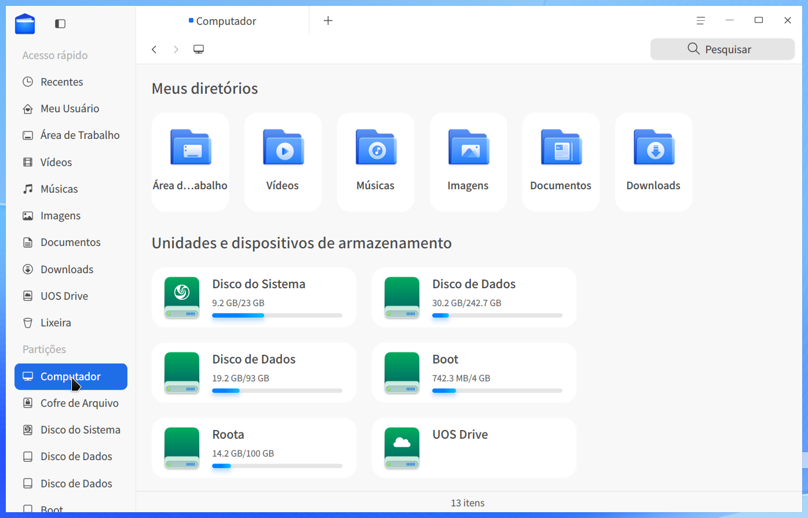

## Primeiros passos

Use as opções a seguir para iniciar ou fechar o Gerenciador de Arquivos e criar atalhos para o aplicativo.

### Iniciar o Gerenciador de Arquivos

1. Clique no ícone do Inicializador  no Dock.
2. Role a lista de aplicativos ou use a pesquisa para localizar o ícone do Gerenciador de Arquivos . Em seguida, clique no ícone para iniciar o aplicativo.
3. Clique com o botão direito do mouse em  para acessar opções como:
   - **Enviar para área de trabalho**: cria um atalho na área de trabalho.
   - A opção do Dock fixa ou remove o aplicativo; quando o ícone já está fixado, o menu mostra **Remover do dock**.
   - **Adicionar à inicialização**: inicia o aplicativo quando o computador é ligado.

>  Dica: também é possível iniciar o Gerenciador de Arquivos com **Super + E**.

### Fechar o Gerenciador de Arquivos

- Na janela do Gerenciador de Arquivos, clique em .
- Clique com o botão direito do mouse no ícone  no Dock e selecione **Fechar tudo**.
- Na janela do Gerenciador de Arquivos, clique em  e selecione **Sair**.

### Consultar os atalhos de teclado

Na janela do Gerenciador de Arquivos, pressione **Ctrl + Shift + /** para exibir a lista de atalhos de teclado. O uso desses atalhos torna as operações mais rápidas.

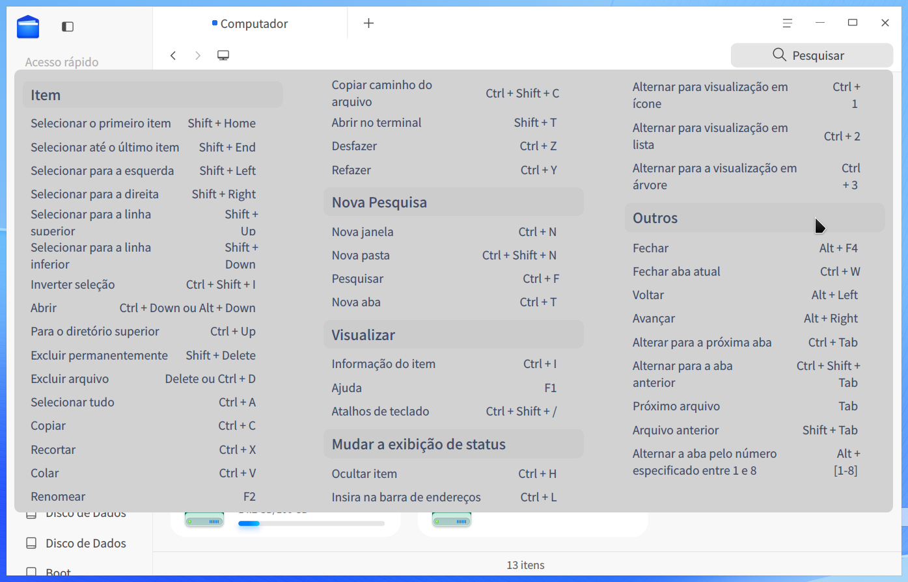

## Interface principal

A interface principal reúne a navegação, a barra de endereços, a pesquisa, os controles de visualização e o menu principal em uma única janela.

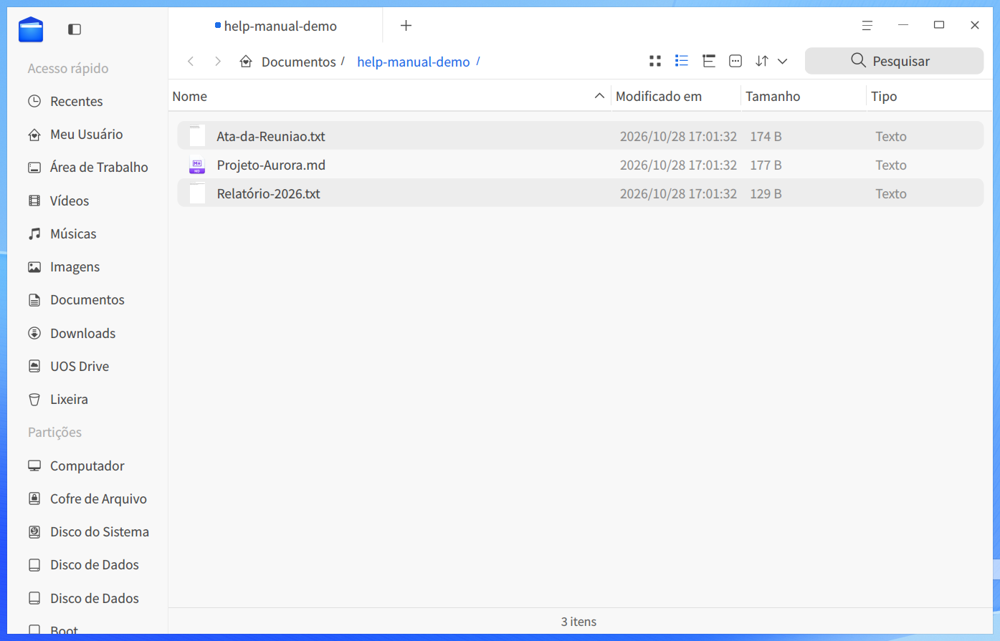

| Área | Descrição |
| --- | --- |
| Painel lateral | Acesse rapidamente os diretórios do usuário, dispositivos de armazenamento, a Lixeira e outros locais disponíveis. |
| Barra de endereços | Volte ou avance no histórico, suba um nível e navegue pelos componentes do caminho atual. |
| Modos de visualização | Alterne entre a visualização em ícones, em lista ou em árvore. |
| Opções de visualização | Ajuste o tamanho dos ícones, a densidade da grade e a pré-visualização. |
| Pesquisa | Pesquise arquivos e pastas no local atual. |
| Menu principal | Crie janelas e abas, conecte-se a servidores, abra as configurações, altere o tema, consulte a ajuda e saia do aplicativo. |
| Barra de status | Consulte a quantidade de itens e ajuste o tamanho dos ícones quando esse controle estiver disponível. |

>  Dica: arraste a divisória à direita do painel lateral para alterar sua largura.

## Funções básicas

O Gerenciador de Arquivos oferece as operações essenciais para criar, copiar, renomear e excluir arquivos e pastas.

### Criar arquivos e pastas

#### Criar um documento

1. Clique com o botão direito do mouse em uma área vazia da janela.
2. Selecione **Novo documento**.
3. Selecione o tipo de arquivo: **Texto**, **Planilha**, **Apresentação** ou **Texto simples**.
4. Digite um nome para o novo arquivo e pressione **Enter**.

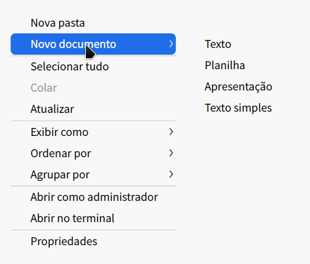

#### Criar uma pasta

1. Clique com o botão direito do mouse em uma área vazia da janela.
2. Selecione **Nova pasta**.
3. Digite um nome para a pasta e pressione **Enter**.

### Renomear um arquivo

1. Clique com o botão direito do mouse no arquivo.
2. Selecione **Renomear**.
3. Digite o novo nome e pressione **Enter** ou clique em uma área vazia da janela.

### Renomear vários arquivos

1. Selecione dois ou mais arquivos.
2. Clique com o botão direito do mouse nos itens selecionados e escolha **Renomear**.
3. Selecione uma regra:
   - **Substituir texto**: localiza um texto nos nomes e o substitui pelo texto informado.
   - **Adicionar texto**: acrescenta o texto informado antes ou depois do nome.
   - **Texto personalizado**: usa um nome comum e uma sequência numérica para gerar os novos nomes.
4. Revise o resultado e clique em **Renomear**.

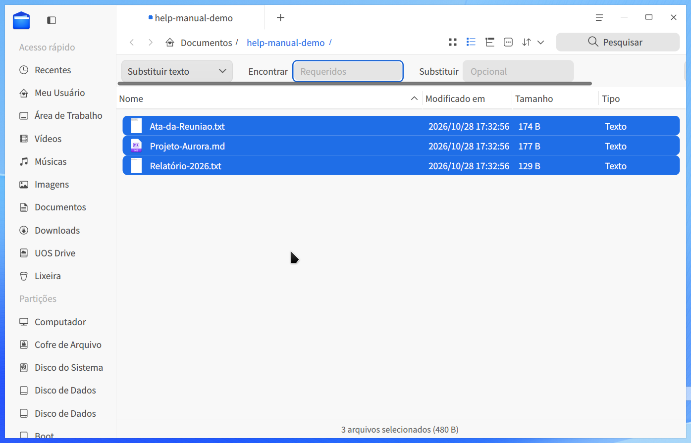

### Alterar o modo de visualização

Clique nos ícones ,  e  na barra de ferramentas ou use **Ctrl + 1**, **Ctrl + 2** e **Ctrl + 3** para alternar entre a visualização em ícones, em lista e em árvore.

- **Visualização em ícones**: exibe os nomes, ícones ou miniaturas dos itens em uma grade.

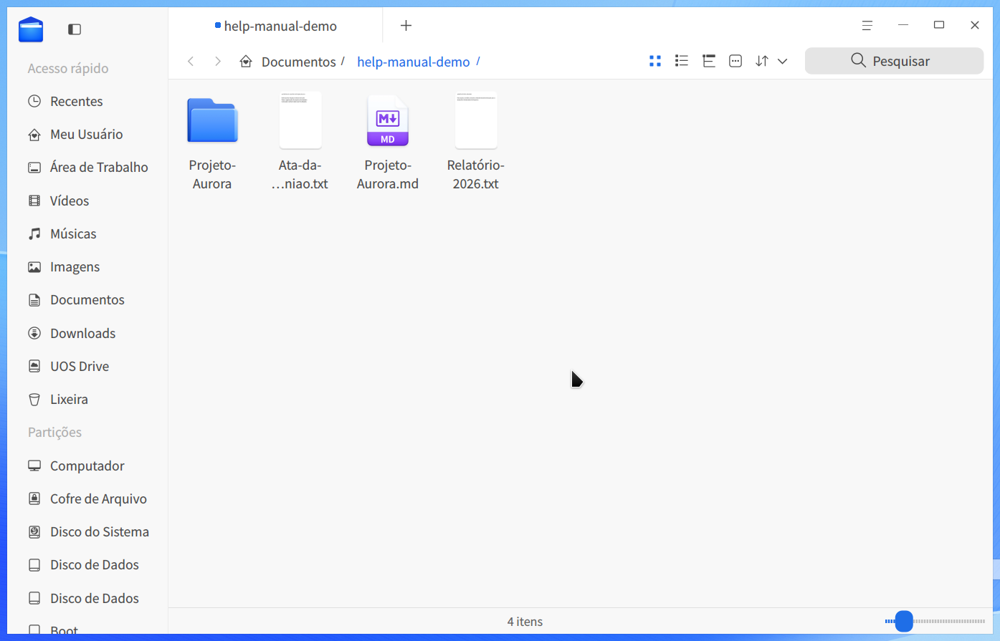

- **Visualização em lista**: exibe os itens em linhas, com nome, data de modificação, tamanho, tipo, ícone ou miniatura.

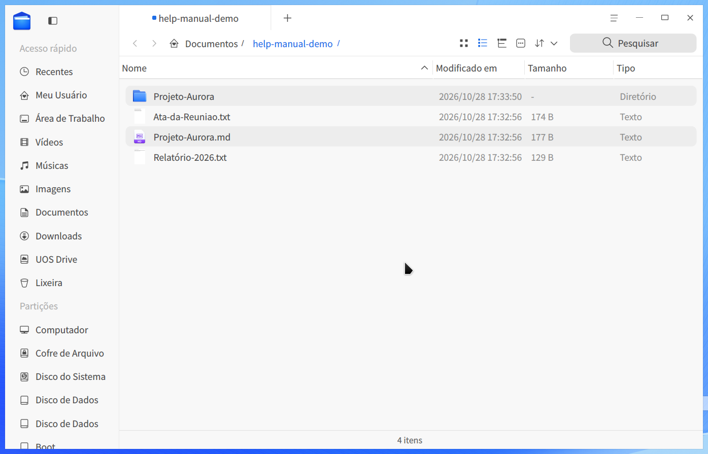

- **Visualização em árvore**: permite expandir pastas na própria lista e mostra nome, data de modificação, tamanho, tipo, ícone ou miniatura.

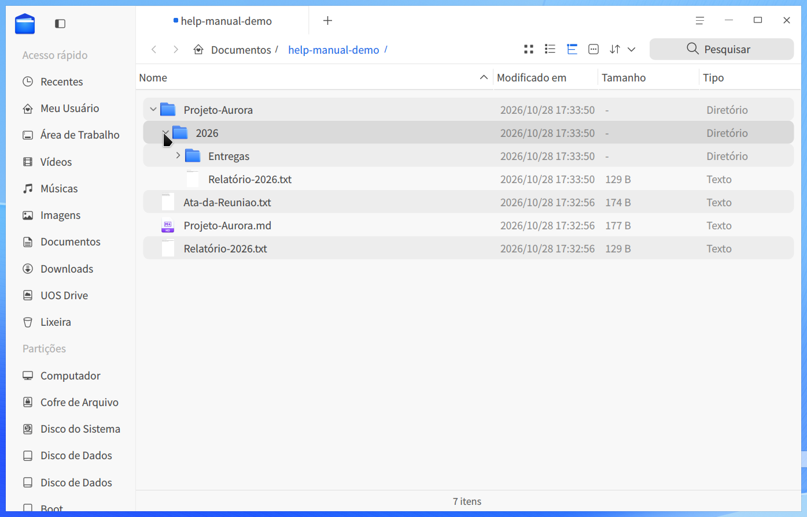

>  Dica: na visualização em lista, arraste o separador entre duas colunas para alterar a largura. Clique duas vezes no separador para ajustar a coluna ao conteúdo mais largo.

### Ordenar arquivos

1. Clique com o botão direito do mouse em uma área vazia da janela.
2. Selecione **Ordenar por**.
3. Escolha **Nome**, **Modificado em**, **Tamanho** ou **Tipo**.

>  Dica: na visualização em lista, clique no título de uma coluna para alternar entre a ordem crescente e a decrescente.

### Abrir um arquivo com outro aplicativo

1. Clique com o botão direito do mouse no arquivo.
2. Selecione **Abrir com**.
3. Selecione um dos aplicativos exibidos ou escolha **Alterar aplicativo padrão**.

>  Nota: um clique duplo abre o arquivo no aplicativo padrão. Para arquivos compatíveis, é possível selecionar vários itens e usar **Abrir com**.

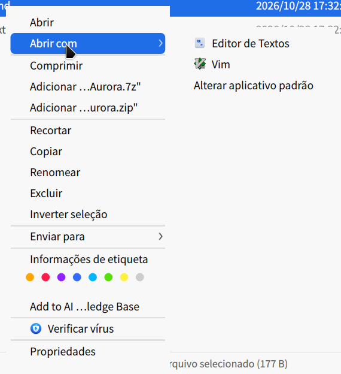

### Ocultar um arquivo

1. Clique com o botão direito do mouse no arquivo e selecione **Propriedades**.
2. Em **Informações básicas**, marque **Ocultar este arquivo**.

### Copiar um arquivo

1. Clique com o botão direito do mouse no arquivo e selecione **Copiar**.
2. Abra a pasta de destino.
3. Clique com o botão direito do mouse em uma área vazia e selecione **Colar**.

### Compactar arquivos

1. Clique com o botão direito do mouse em um arquivo ou uma pasta.
2. Selecione **Comprimir**.
3. No Gerenciador de Arquivos Compactados, defina o formato, o nome e o local do arquivo compactado e confirme a operação.

>  Dica: use **Adicionar a “nome.7z”** ou **Adicionar a “nome.zip”** no menu de contexto para criar rapidamente um arquivo 7z ou ZIP.

### Excluir arquivos

1. Clique com o botão direito do mouse no arquivo.
2. Selecione **Excluir**.
   - Em locais compatíveis com a Lixeira, o item pode ser restaurado ou excluído permanentemente pela **Lixeira**.
   - Em alguns dispositivos externos, a exclusão pode ser permanente. Leia a mensagem de confirmação antes de continuar.
   - Os atalhos que apontam para um item excluído deixam de funcionar.

>  Nota: em **Menu principal** > **Configurações** > **Avançado** > **Caixa de diálogo**, marque **Solicitar confirmação ao excluir arquivos** para exibir uma confirmação nas exclusões normais.

### Desfazer uma operação

Pressione **Ctrl + Z** para desfazer a operação anterior quando ela for compatível. Entre os exemplos estão:

- remover um arquivo recém-criado;
- restaurar o nome anterior de um item;
- restaurar um item enviado recentemente para a Lixeira;
- retornar um item movido ao local de origem;
- remover uma cópia criada pela operação de colar.

>  Atenção: operações como substituição de um arquivo existente ou exclusão permanente podem limitar ou impedir a ação de desfazer.

### Consultar as propriedades

A janela de propriedades mostra informações básicas, o aplicativo usado para abrir o item e as permissões. Para pastas, também podem ser exibidas opções de compartilhamento.

1. Clique com o botão direito do mouse no arquivo ou na pasta.
2. Selecione **Propriedades**. Também é possível pressionar **Ctrl + I**.

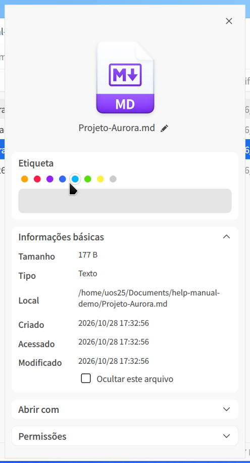

>  Nota: as propriedades de um atalho também mostram o local do item de origem.

#### Consultar as propriedades de vários arquivos

1. Selecione dois ou mais arquivos ou pastas.
2. Pressione **Ctrl + I** ou clique com o botão direito do mouse e selecione **Propriedades**.
3. O sistema abre uma janela de propriedades para cada item selecionado. Uma barra de resumo mostra o tamanho total e a quantidade de itens.
4. Consulte ou altere as opções em cada janela separadamente. Use **Fechar tudo** na barra de resumo para fechar todas as janelas de propriedades.

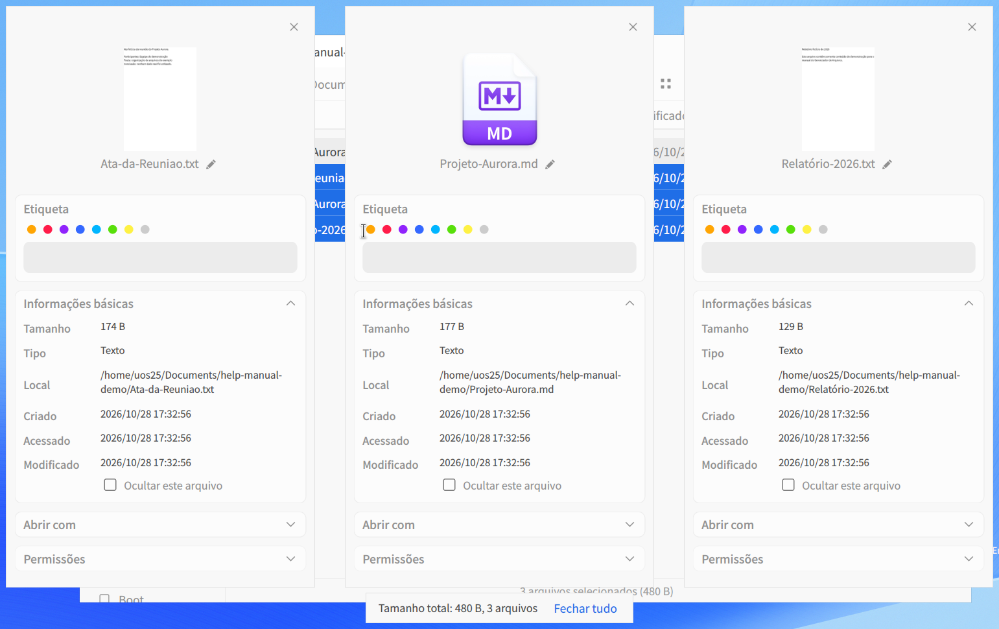

### Destruir arquivos

#### Ativar a destruição de arquivos

1. Abra **Menu principal** > **Configurações**.
2. No grupo **Avançado**, selecione **Destruir arquivo**.
3. Ative **Ativar destruição de arquivos**.

#### Destruir um arquivo ou uma pasta

1. Selecione um ou mais itens que possam ser excluídos permanentemente.
2. Clique com o botão direito do mouse nos itens e selecione **Destruir arquivo**.
3. Confira a lista no diálogo de confirmação e clique em **Destruir** para continuar ou em **Cancelar** para interromper a operação.

>  Atenção: a destruição exclui os itens permanentemente. Eles não podem ser recuperados pela Lixeira. Confira cuidadosamente a lista antes de continuar.

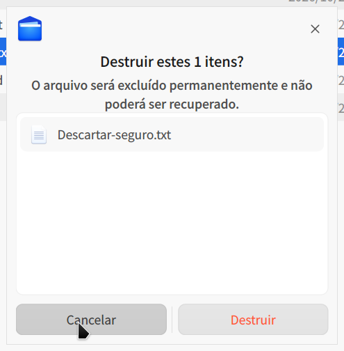

### Verificar vírus

1. Clique com o botão direito do mouse em um arquivo ou uma pasta.
2. Selecione **Verificar vírus** para abrir a Central de Segurança e iniciar a verificação do item.

>  Nota: a opção depende da integração com a Central de Segurança. Se ela não aparecer, verifique nas configurações da Central de Segurança se a opção de adicionar a verificação de vírus ao menu de contexto está ativada.

## Operações comuns

Esta seção apresenta os recursos usados com mais frequência para localizar, organizar, identificar e compartilhar arquivos.

### Alternar a barra de endereços

Normalmente, a barra de endereços mostra o caminho atual em componentes clicáveis. Use os botões de histórico para voltar ou avançar e clique em um componente para acessar diretamente esse nível.

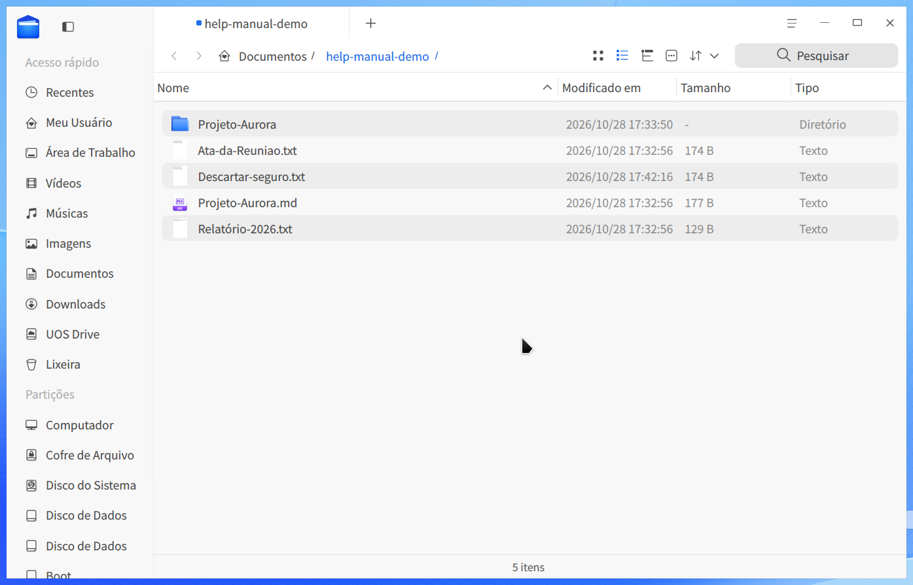

Pressione **Ctrl + L** para alternar para o campo de edição. Digite ou cole um caminho e pressione **Enter**. Clique fora do campo ou pressione **Esc** para voltar à exibição em componentes.

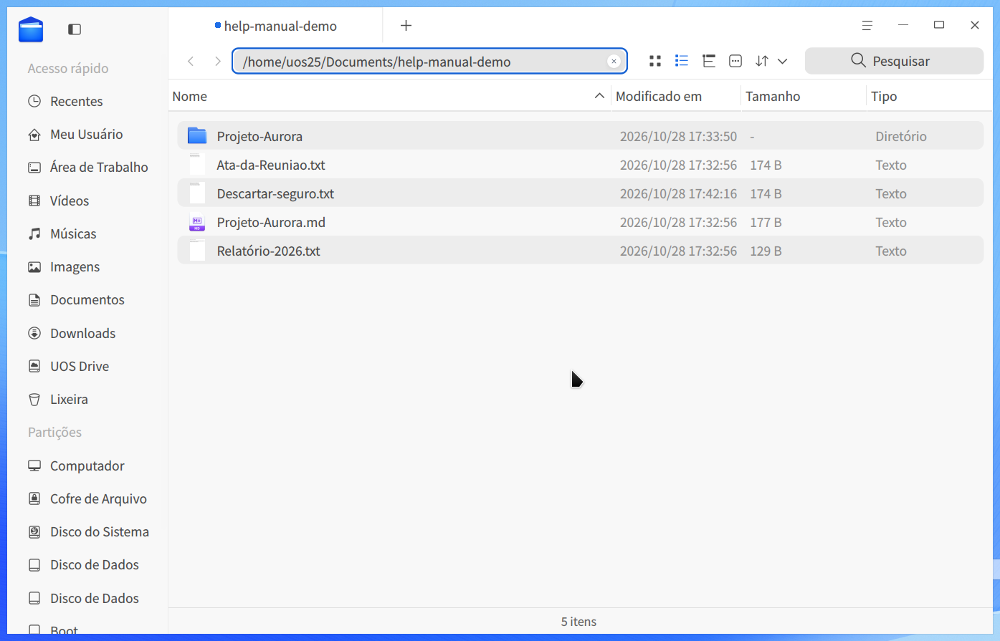

#### Acessar um caminho diretamente

1. Pressione **Ctrl + L**.
2. Digite um caminho absoluto válido.
3. Pressione **Enter**.
   - Se o caminho apontar para uma pasta, o conteúdo será exibido na janela atual.
   - Se apontar para um arquivo, o item será aberto com o aplicativo padrão.
   - Em uma caixa de seleção de arquivos, o item correspondente será selecionado.

### Pesquisar arquivos

Abra primeiro a pasta que será pesquisada. Pressione **Ctrl + F** ou clique em **Pesquisar**, digite uma palavra e pressione **Enter**. A pesquisa localiza correspondências no nome e, quando a pesquisa de conteúdo está ativada, também no conteúdo de arquivos compatíveis.

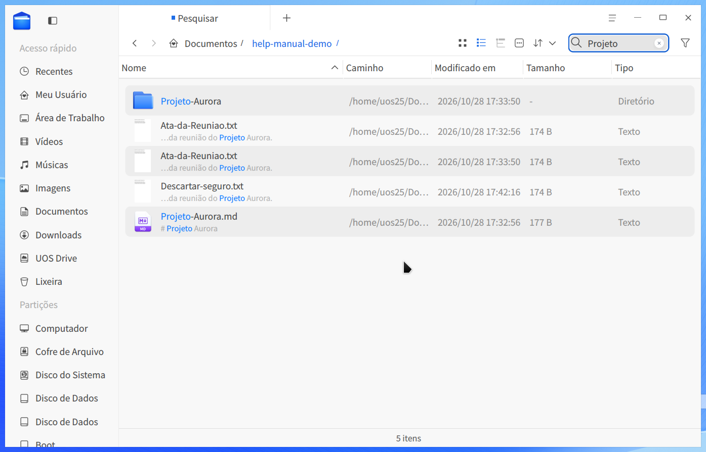

Clique no ícone de filtro ao lado da caixa de pesquisa para restringir os resultados por tipo, tamanho ou data, quando essas opções estiverem disponíveis.

>  Nota: as opções de índice em **Configurações** > **Avançado** alteram o alcance e a velocidade da pesquisa.

### Itens recentes

Selecione **Recentes** no painel lateral para consultar os arquivos usados recentemente. Use **Remover dos recentes** para apagar somente o registro de acesso; o arquivo original não é excluído.

### Usar várias abas

- Pressione **Ctrl + T** ou clique em **+** para criar uma aba.
- Clique em uma aba para ativá-la.
- Pressione **Ctrl + W** para fechar a aba atual.
- Arraste uma aba para alterar sua posição.

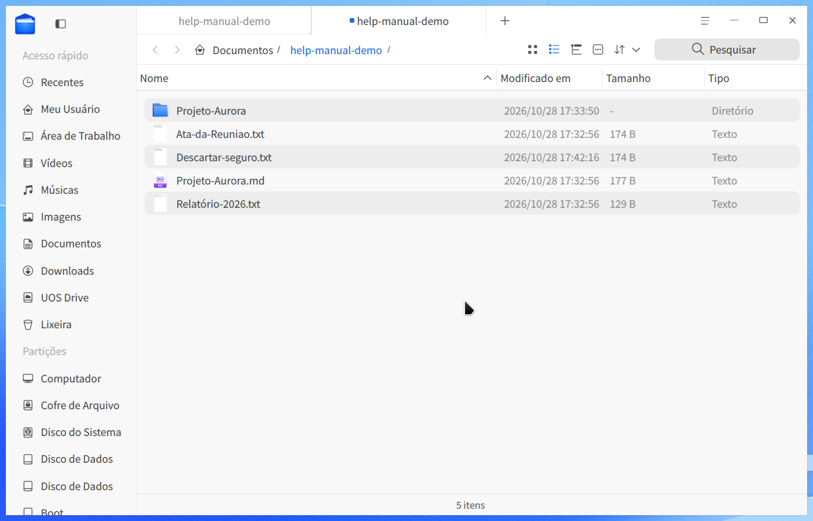

### Diretório em árvore no painel lateral

#### Ativar o diretório em árvore

1. Abra **Menu principal** > **Configurações**.
2. Em **Barra Lateral**, selecione **Sidebar tree directory**.
3. Marque **Display sidebar disk partitions as a tree structure**.

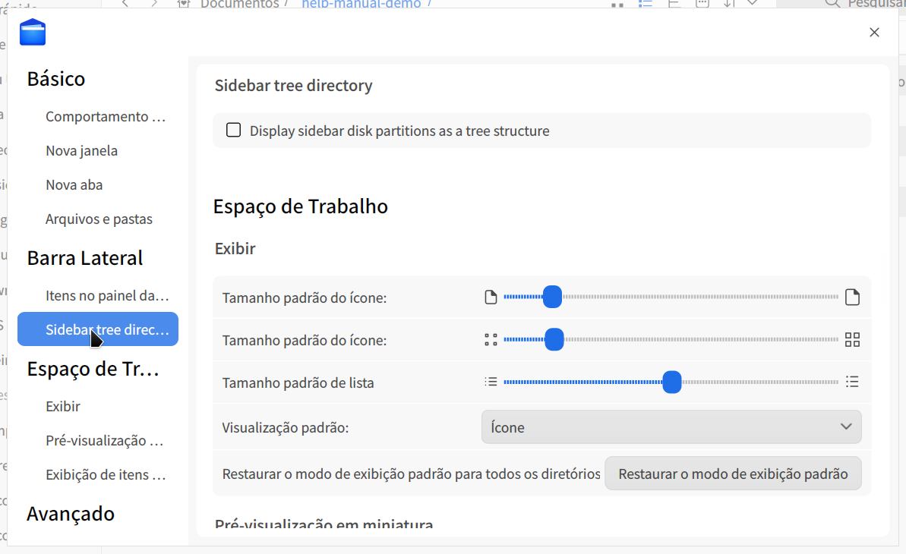

>  Nota: nesta versão, o título e a opção desse recurso ainda aparecem em inglês na interface em português do Brasil.

#### Usar o diretório em árvore

Clique no controle de expansão ao lado de uma partição para mostrar ou ocultar seus diretórios. Clique em uma pasta para abrir o conteúdo.

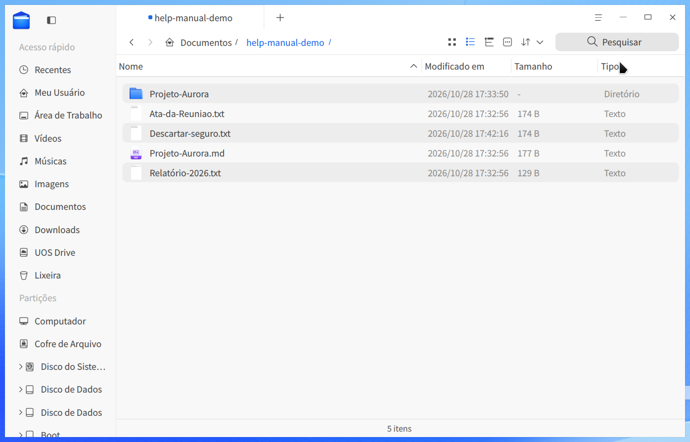

### Gerenciar favoritos

Arraste uma pasta para a área de favoritos no painel lateral ou use a opção disponível no menu de contexto. Arraste as entradas para reordená-las. Use **Remover** para retirar o favorito sem excluir a pasta original.

### Usar etiquetas

As etiquetas identificam arquivos e pastas por cor.

#### Adicionar ou remover uma etiqueta

1. Clique com o botão direito do mouse em um item.
2. Em **Informações de etiqueta**, clique em uma cor.

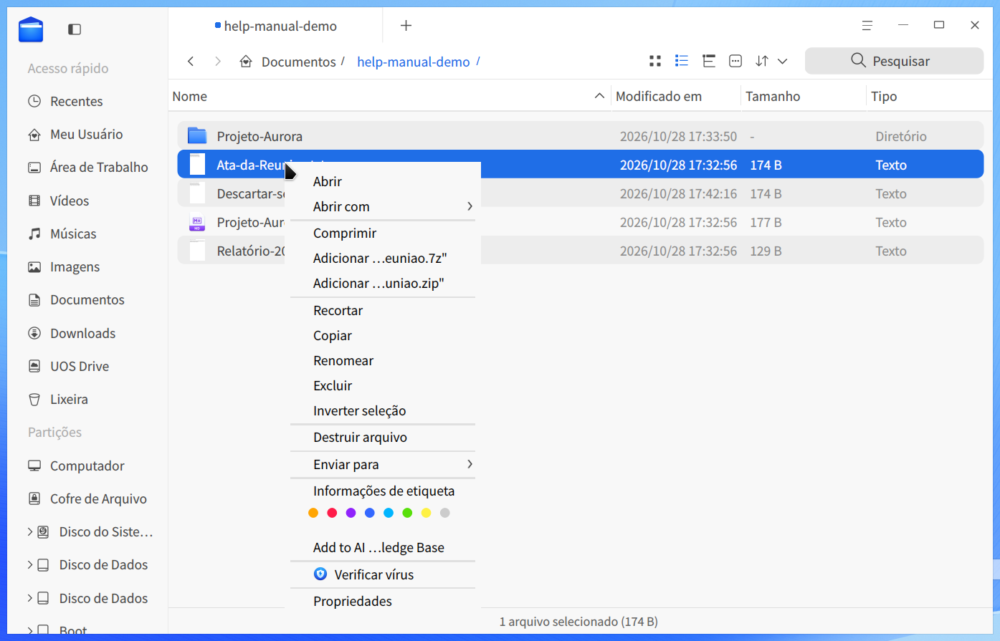

Para remover a etiqueta, abra novamente o menu e clique na cor aplicada. O menu mostra a ação correspondente, por exemplo **Remover tag “Verde”**.

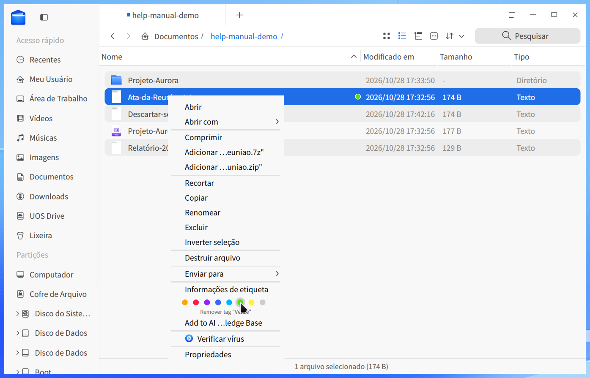

Também é possível ativar **Pré-visualizar tela** em **Opções de visualização** e usar as cores da seção **Etiqueta**.

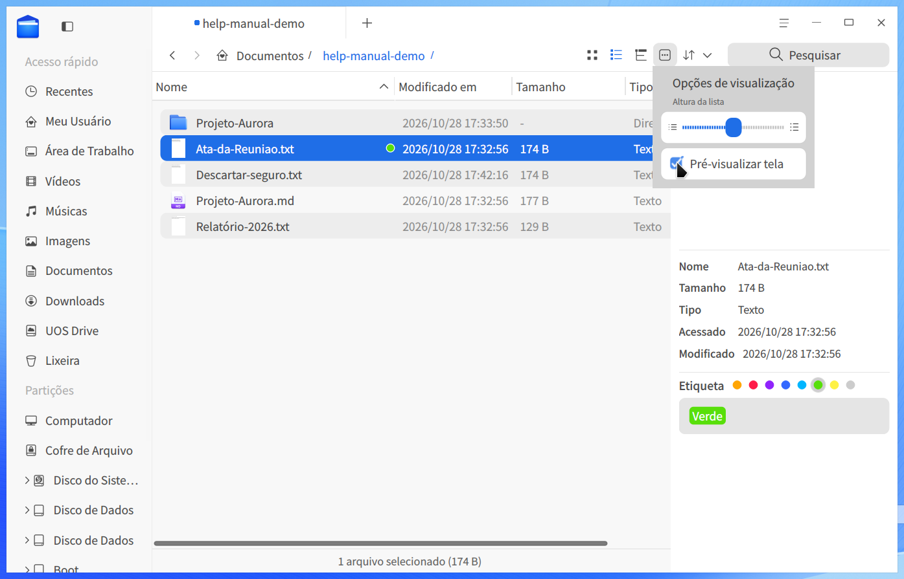

#### Renomear e organizar etiquetas

Quando uma etiqueta aparece no painel lateral, clique nela com o botão direito do mouse para acessar as ações disponíveis, como renomear, remover ou alterar a cor. Arraste as entradas para alterar a ordem quando esse comportamento estiver disponível.

### Pré-visualizar arquivos

Selecione um arquivo compatível e pressione **Espaço**. Use as setas para navegar entre os itens e pressione **Esc** para sair.

#### Pré-visualizar um vídeo

A pré-visualização mostra o nome, a reprodução, a linha do tempo, a duração e o botão **Abrir**.

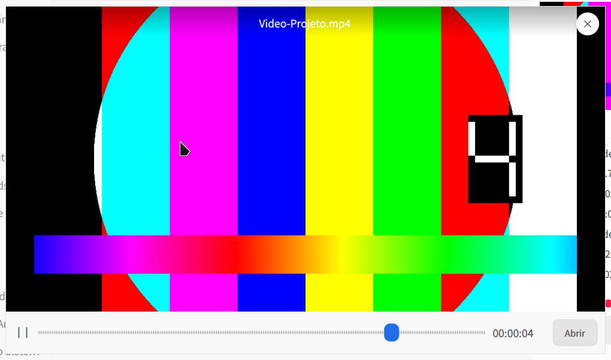

>  Nota: a reprodução depende dos codecs instalados e do formato do arquivo.

### Gerenciar permissões

1. Abra as **Propriedades** do item.
2. Expanda **Permissões**.
3. Defina as permissões do **Proprietário**, do **Grupo** e de **Outros**.
4. Para arquivos executáveis confiáveis, marque **Executar como programa** quando necessário.

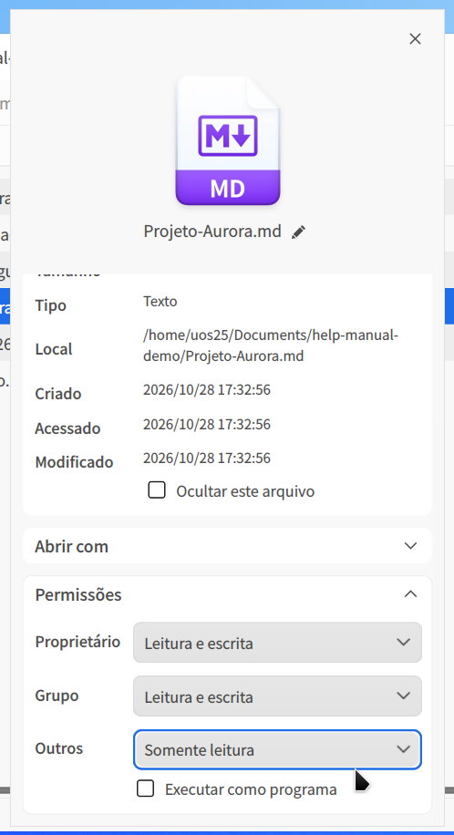

>  Atenção: permissões incorretas podem impedir o acesso ou expor dados a outros usuários.

### Compartilhar pastas na rede

#### Compartilhar uma pasta local

1. Abra as **Propriedades** da pasta.
2. Expanda **Compartilhamento**.
3. Marque **Compartilhar esta pasta**.
4. Defina o nome, as permissões e o acesso anônimo.
5. Se solicitado, defina uma senha em **Menu principal** > **Definir senha de compartilhamento**.

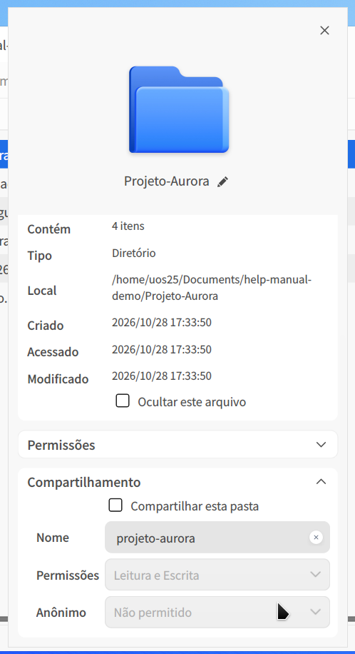

>  Atenção: confirme as permissões e desative o compartilhamento quando ele não for mais necessário.

#### Acessar uma pasta compartilhada

1. Abra **Menu principal** > **Conectar-se ao servidor**.
2. Informe o endereço fornecido pelo administrador.
3. Clique em **Conectar**.
4. Se solicitado, selecione o tipo de identidade e informe o usuário, o domínio e a senha.

>  Nota: esta etapa exige um servidor acessível e credenciais válidas.

#### Parar de compartilhar

Abra as **Propriedades** da pasta, expanda **Compartilhamento** e desmarque **Compartilhar esta pasta**.

### Abrir como administrador

Clique com o botão direito do mouse em uma pasta e selecione **Abrir como administrador**. Confirme a autenticação somente para uma tarefa administrativa.

>  Atenção: esse modo permite modificar arquivos protegidos do sistema. Feche a janela quando terminar.

### Abrir no terminal

Clique com o botão direito do mouse em uma área vazia da pasta e selecione **Abrir no terminal**.

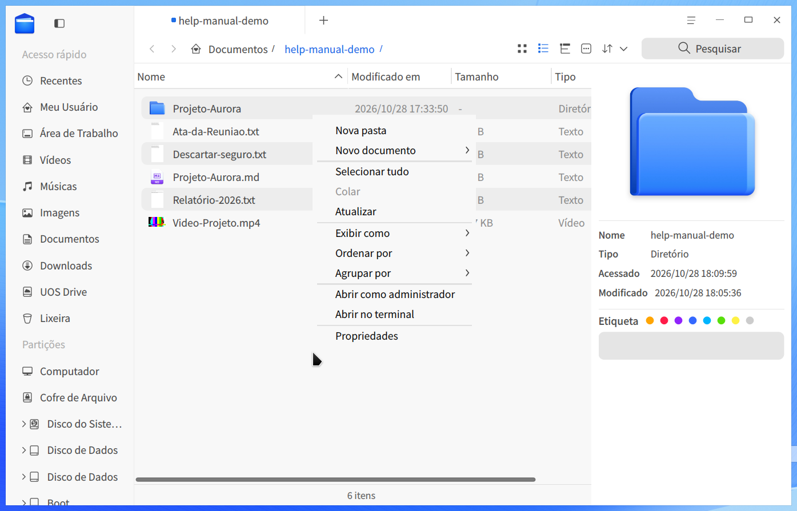

### Gravar discos ópticos

Os comandos aparecem somente quando uma unidade óptica compatível está disponível.

#### Gravar arquivos locais

Insira um disco gravável, selecione os arquivos, use a opção de gravação disponível e revise as configurações antes de iniciar.

#### Apagar um disco regravável

Clique com o botão direito do mouse no disco e selecione **Apagar**. Confirme somente depois de verificar o conteúdo.

#### Trabalhar com uma imagem ISO

Use o menu do disco para salvar seu conteúdo como uma imagem ISO. Para gravar uma imagem existente, selecione o arquivo ISO e use a opção de gravação correspondente.

>  Nota: esses fluxos exigem unidade óptica e mídia compatíveis.

### Criar um atalho

Clique com o botão direito do mouse no item, selecione **Criar link** e mova o link para o local desejado. Use **Enviar para área de trabalho** para criar o atalho diretamente na área de trabalho.

### Enviar arquivos para um dispositivo externo

Conecte e monte o dispositivo, copie os itens, aguarde a conclusão e remova o dispositivo com segurança.

### Enviar arquivos por Bluetooth

Ative e pareie os dispositivos. Selecione o arquivo e use **Enviar para** > **Bluetooth**, quando essa integração estiver disponível.

### Reparar uma unidade USB

Se o Gerenciador de Arquivos detectar um erro, use a opção de reparo exibida. Desmonte a unidade quando solicitado e aguarde o resultado.

>  Atenção: interrompa o uso se o reparo falhar e procure ajuda especializada quando houver dados importantes.

## Assistente de celular

O Assistente de celular permite conectar um telefone Android quando o recurso e o aplicativo complementar são compatíveis.

### Preparação

Abra a entrada de celular no painel lateral ou na bandeja, instale o aplicativo complementar, entre na conta quando solicitado e configure a descoberta.

### Conectar o telefone

- **Código QR**: abra a tela de conexão no computador e escaneie o código com o telefone.
- **Pesquisar computador**: procure o computador no aplicativo e confirme a solicitação nos dois dispositivos.

### Gerenciar arquivos do telefone

Depois de conectar, use a entrada do telefone para consultar fotos, vídeos, documentos e outros arquivos. Aguarde o término de cada transferência antes de desconectar.

>  Nota: a disponibilidade depende do telefone, do Android e dos serviços instalados.

## Emblemas de arquivos

O comando **gio set** pode associar emblemas a arquivos e pastas.

### Adicionar um emblema

    gio set CAMINHO_DO_ARQUIVO -t stringv metadata::emblems "CAMINHO_DO_ICONE"

Para indicar um canto, acrescente **;lu**, **;ld**, **;ru** ou **;rd** ao caminho do ícone.

### Adicionar vários emblemas

Separe de dois a quatro emblemas com **|**. Um mesmo canto aceita apenas um emblema.

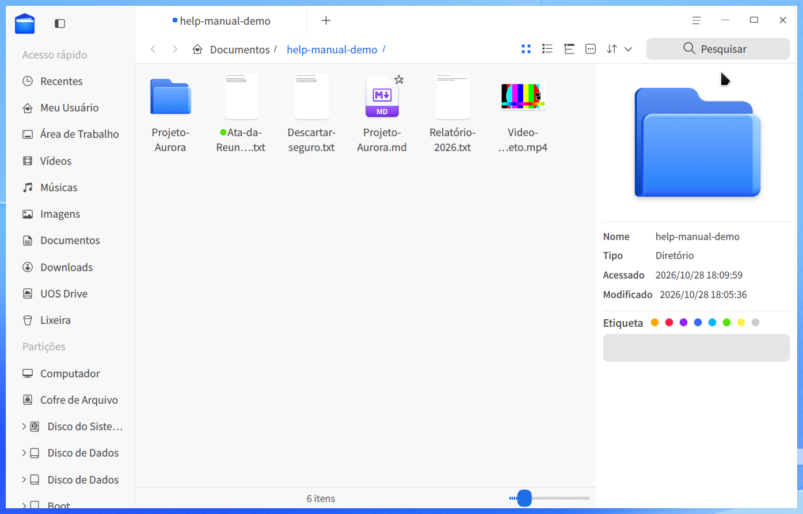

>  Nota: no UOS V25 verificado, o metadado com vários caminhos foi aceito, mas a interface exibiu somente o primeiro emblema. Confirme o resultado visual antes de depender de vários emblemas.

### Remover os emblemas

    gio set CAMINHO_DO_ARQUIVO -t stringv metadata::emblems ""

>  Nota: alguns dispositivos e sistemas de arquivos não mantêm esses metadados.

## Cofre de Arquivo

O **Cofre de Arquivo** cria uma área protegida para dados particulares.

### Configurar o cofre

1. Selecione **Cofre de Arquivo** no painel lateral.
2. Clique em **Criar** quando o assistente for exibido.
3. Escolha o método oferecido:
   - **Criptografia transparente**: usa a autenticação da sessão.
   - **Criptografia de chave**: usa uma senha e um arquivo de chave.
4. Siga o assistente e confirme a autenticação do sistema.

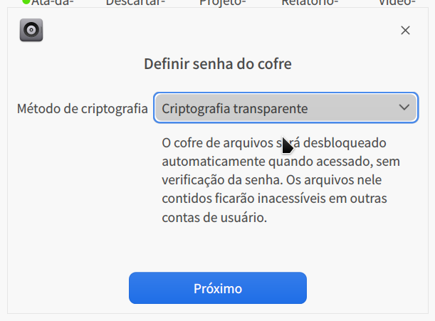

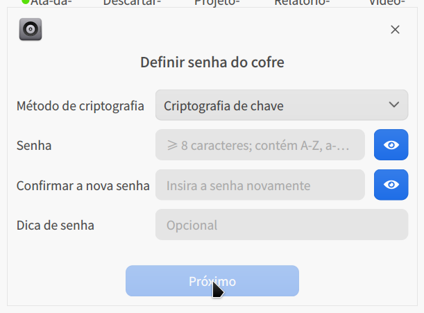

Use uma senha forte e guarde o arquivo de chave em um local seguro e separado.

### Bloquear e desbloquear

Use o menu de contexto do **Cofre de Arquivo** para bloquear imediatamente ou configurar o bloqueio automático. Para desbloquear, abra o cofre e informe a senha quando solicitada.

### Excluir o cofre

Desbloqueie o cofre, faça backup dos dados e use a opção de exclusão no menu de contexto.

>  Atenção: excluir o cofre remove permanentemente o conteúdo. Faça backup antes de confirmar.

## Gerenciamento de discos

O painel lateral e a página **Computador** mostram as partições locais e os dispositivos externos montados.

### Discos locais

Para ocultar categorias, ajuste os itens do painel lateral nas **Configurações**. Para alterar um nome que aceite essa operação, use **Renomear** no menu de contexto.

### Discos externos

#### Remover com segurança

Aguarde as cópias, clique no botão de desmontagem ou use **Desmontar**, **Remover com segurança** ou **Ejetar**. Retire o dispositivo somente após a confirmação.

#### Renomear

Desmonte o volume quando solicitado, selecione **Renomear**, informe o novo rótulo e confirme.

#### Formatar

Faça backup, desmonte o volume, selecione **Formatar**, revise o dispositivo, escolha o sistema de arquivos e confirme.

>  Atenção: a formatação apaga os dados do volume.

## Menu principal

O menu principal reúne os comandos de janela, conexão, configuração, tema, ajuda e encerramento.

### Nova janela

Abra **Menu principal** > **Nova janela**.

### Nova aba

Abra **Menu principal** > **Nova aba** ou pressione **Ctrl + T**.

### Conectar-se ao servidor

Abra **Menu principal** > **Conectar-se ao servidor**, informe o endereço compatível e clique em **Conectar**. Informe as credenciais se solicitado.

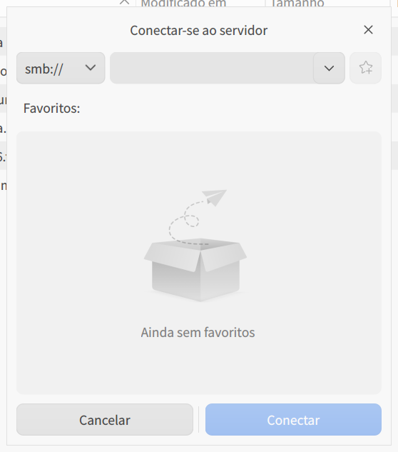

### Configurações

Abra **Menu principal** > **Configurações**.

#### Básico

A página **Básico** permite configurar o comportamento ao abrir itens, os locais de novas janelas e abas, arquivos e pastas, itens do painel lateral, visualização e miniaturas.

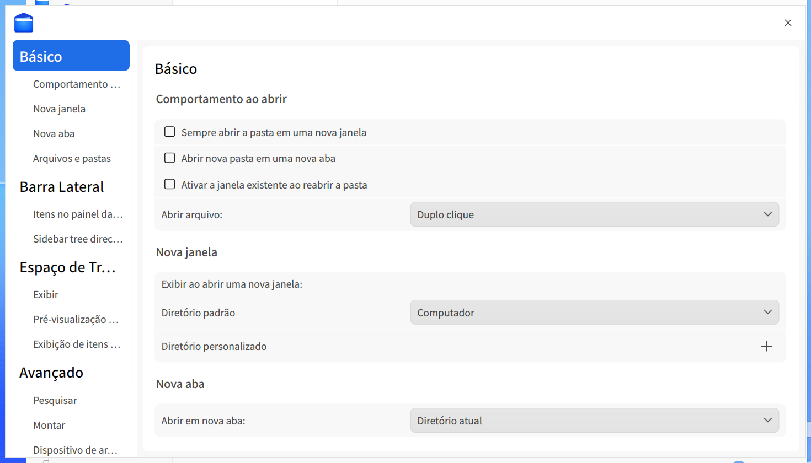

#### Avançado

As categorias podem incluir pesquisa e indexação, pré-visualização, montagem automática, caixas de diálogo, destruição de arquivos e integrações instaladas. As opções dependem dos componentes e das políticas do sistema.

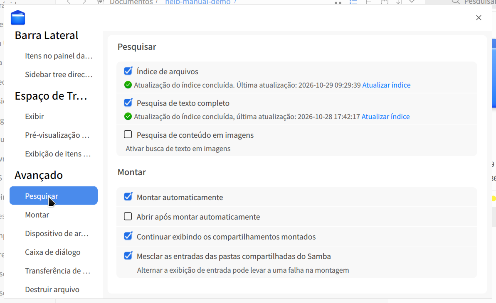

### Tema

Abra **Menu principal** > **Tema** e selecione o tema disponível.

### Ajuda

Abra **Menu principal** > **Ajuda** para consultar este manual.

### Sobre

Abra **Menu principal** > **Sobre** para ver o nome e a versão.

### Sair

Abra **Menu principal** > **Sair** para fechar todas as janelas.
